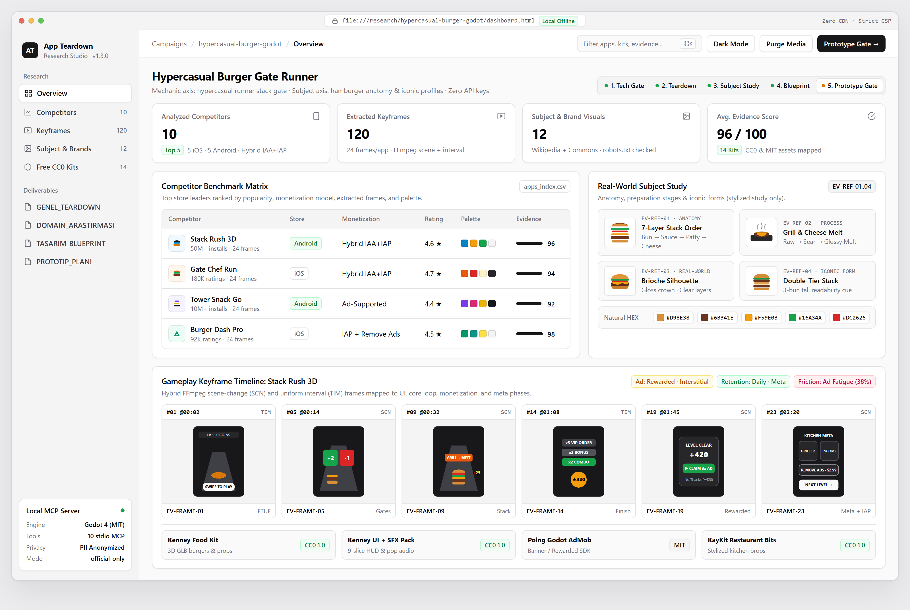

<div align="center">

# App & Game Teardown Research Toolkit

**Análisis competitivo local de apps y juegos móviles para agentes de código AI. Elige tu stack tecnológico (Godot, Unity, Flutter, React Native), analiza el Top 5 en App Store y Google Play cuadro por cuadro desde YouTube, investiga el tema real con fotos de marcas icónicas y anatomía de capas, reúne kits gratuitos CC0 de UI/UX, 3D y SFX, construye un prototipo tras tu aprobación y desarrolla la versión completa cuando confirmes.**

<p>
  <a href="../../README.md">English</a> ·
  <a href="README.tr.md">Türkçe</a> ·
  <a href="README.zh-CN.md">简体中文</a> ·
  <strong>Español</strong> ·
  <a href="README.pt-BR.md">Português</a> ·
  <a href="README.ja.md">日本語</a> ·
  <a href="README.de.md">Deutsch</a> ·
  <a href="README.ko.md">한국어</a>
</p>

<br>

<p>
  
</p>
<p><sub>Panel local autónomo (<code>dashboard.html</code>, sin CDN, CSP estricta, temas Zinc claro y oscuro) generado automáticamente tras cada análisis.</sub></p>

</div>

---

## Qué hace

- **Plan de idea, asesor tecnológico y separación mecánica/dominio (`plan-idea`):** Compara 3 stacks (Godot 4, Unity 6, Phaser o Flutter, React Native, Native) para que elijas primero. Separa la búsqueda de competidores por mecánica de la investigación real del tema.
- **Motor de tema real y referencias visuales de marcas (`research-domain`):** Reúne qué es, cómo se hace, capas/anatomía y marcas famosas (Wikipedia + DuckDuckGo) en `DOMAIN_ARASTIRMASI.md`, descarga fotos de referencia y genera `domain_reference_sheet.png` y `domain_palette_card.png`.
- **Buscador de kits gratuitos (`find-kits`):** Reúne paquetes `CC0`, `MIT` y `SIL OFL` de UI/UX, modelos 3D/2D, audio SFX, fuentes y SDKs (Kenney, KayKit, Quaternius, Poly Pizza, Freesound CC0, Godot AdMob, RevenueCat) en `FREE_ASSET_VE_KIT_REHBERI.md`.
- **Descubrimiento Top 5 en ambas tiendas (sin claves API):** Busca en Google Play y Apple App Store por popularidad, IAP, anuncios y reseñas anonimizadas.
- **YouTube, extracción híbrida de fotogramas y paletas HEX (`yt-dlp` + `FFmpeg` + `Pillow`):** Descarga los primeros 4 minutos de gameplay o walkthrough, extrae 24 fotogramas clave, crea storyboards 3x4 y `color_palette_card.png`.
- **Flujo Prototipo -> Feedback -> Versión completa (`PROTOTIP_VE_TAM_SURUM_PLANI.md`):** Al terminar los informes pregunta si quieres un prototipo rápido, detalla qué se añadirá en la versión final, recoge tu feedback y solo construye la app completa cuando das el visto bueno.
- **Modo oficial y limpieza de medios (`--official-only`, `purge-media`):** Permite restringir las consultas a APIs oficiales y abiertas (Apple iTunes, Wikipedia, Wikimedia Commons, Openverse), respeta `robots.txt` y borra medios de terceros manteniendo intactos tus informes Markdown.

## Instalación rápida

```bash
npx skills add https://github.com/koraybaysoy/app-teardown-research
git clone https://github.com/koraybaysoy/app-teardown-research.git
cd app-teardown-research
bash ./setup.sh   # En Windows: .\setup.ps1
```

## Licencia

[MIT](../../LICENSE)
