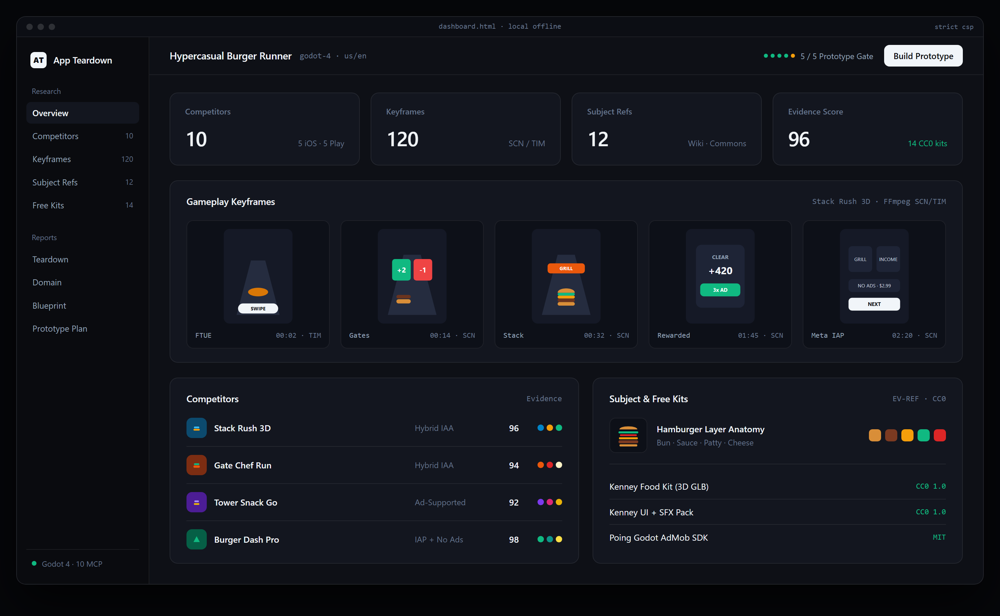

<div align="center">

# App & Game Teardown Research Toolkit

**AIコーディングエージェント向けのモバイルアプリ・ゲーム設計前競合分析ツールキット。技術スタック選定（Godot、Unity、Flutter、React Native）、App Store・Google Play 上位5件のYouTubeフレーム分解、現実世界の題材・構造・有名ブランド参照写真の収集、無料CC0 UI/UX・3D・効果音キット選定、試作プロトタイプ確認とフィードバック後の本実装までをローカルで完結します。**

<p>
  <a href="../../README.md">English</a> ·
  <a href="README.tr.md">Türkçe</a> ·
  <a href="README.zh-CN.md">简体中文</a> ·
  <a href="README.es.md">Español</a> ·
  <a href="README.pt-BR.md">Português</a> ·
  <strong>日本語</strong> ·
  <a href="README.de.md">Deutsch</a> ·
  <a href="README.ko.md">한국어</a>
</p>

<br>

<p>
  
</p>
<p><sub>各調査の完了時に自動生成される完全ローカルのダークモードダッシュボード（<code>dashboard.html</code>、CDN不要、厳格なCSP、ダーク/ライト切替対応）。</sub></p>

</div>

---

## 主な機能

- **アイデア分解・技術選定 (`plan-idea`)：** Godot 4 / Unity 6 / Phaser または Flutter / React Native / Native の3案を比較提示し、競合メカニクス調査と現実世界の題材調査を分離します。
- **現実世界の題材・構造・有名ブランド参照画像収集 (`research-domain`)：** 定義・作り方・層構造・有名ブランド（Wikipedia + DuckDuckGo）を `DOMAIN_ARASTIRMASI.md` にまとめ、参照写真から `domain_reference_sheet.png` と `domain_palette_card.png` を生成します。
- **無料 UI/UX・3D/2Dモデル・SFX・SDKキット検索 (`find-kits`)：** 選んだ技術とテーマに合う `CC0` / `MIT` / `SIL OFL` 素材（Kenney、KayKit、Quaternius、Poly Pizza、Freesound CC0、Godot AdMob、RevenueCat）を `FREE_ASSET_VE_KIT_REHBERI.md` にまとめます。
- **両ストア人気トップ5発見（APIキー不要）：** Google Play と Apple App Store から競合、IAP価格帯、広告フラグ、匿名化レビューを取得します。
- **YouTube実機取得・フレーム抽出・配色解析 (`yt-dlp` + `FFmpeg` + `Pillow`)：** 冒頭4分から24フレームを抽出し、3x4ストーリーボードと `color_palette_card.png` を生成します。
- **プロトタイプ確認・フィードバック・本実装フロー (`PROTOTIP_VE_TAM_SURUM_PLANI.md`)：** 調査完了後にまず軽量プロトタイプ作成を提案し、製品版で追加する要素を提示してフィードバックを得た上で全体を実装します。
- **公式API準拠モードとメディア削除 (`--official-only`, `purge-media`)：** Apple iTunes / Wikipedia / Wikimedia Commons / Openverse の公式・オープンAPIのみに制限でき、`robots.txt` を尊重し、レポートを残して第三者メディアを一括削除できます。

## クイックセットアップ

```bash
npx skills add https://github.com/koraybaysoy/app-teardown-research
git clone https://github.com/koraybaysoy/app-teardown-research.git
cd app-teardown-research
bash ./setup.sh   # Windows: .\setup.ps1
```

## ライセンス

[MIT](../../LICENSE)
