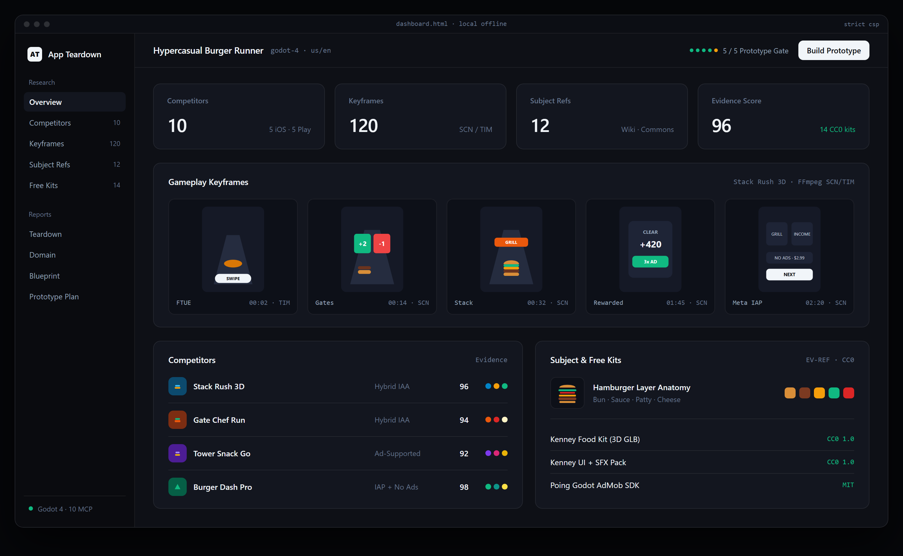

<div align="center">

# App & Game Teardown Research Toolkit

**Yeni bir mobil uygulama veya mobil oyun kodlamadan önce tam rakip analizi ve ürün teardown aracı. Teknoloji yığınını seç, App Store ve Google Play'deki en popüler 5 rakibi YouTube oynanış kareleriyle incele, fikrinin gerçek hayattaki karşılığını (nedir, nasıl yapılır, katmanları ve ünlü marka fotoğrafları) araştır, ücretsiz CC0 UI/UX, 3D model ve ses kitlerini topla ve üretime hazır tasarım blueprint'i çıkar.**

<p>
  <a href="../../README.md">English</a> ·
  <strong>Türkçe</strong> ·
  <a href="README.zh-CN.md">简体中文</a> ·
  <a href="README.es.md">Español</a> ·
  <a href="README.pt-BR.md">Português</a> ·
  <a href="README.ja.md">日本語</a> ·
  <a href="README.de.md">Deutsch</a> ·
  <a href="README.ko.md">한국어</a>
</p>

<br>

<p>
  
</p>
<p><sub>Her araştırma sonunda otomatik üretilen yerel koyu tema çalışma paneli (<code>dashboard.html</code>, sıfır CDN, katı CSP, koyu ve açık mod).</sub></p>

</div>

---

## Neden Var?

Yeni bir hypercasual oyun ya da tüketici uygulaması tasarlarken rakip araştırması çoğu zaman günler alır. Rakipleri tek tek indirirsin. YouTube videolarını durdurup HUD dizilimine, paywall zamanlamasına ve reklam sıklığına bakarsın. Renk paleti kodlarını çıkarıp gelir ve retention yazılarını ayrı ayrı toplarsın.

Bu Python eklentisi tüm ürün teardown sürecini API ücreti olmadan kendi bilgisayarında çalıştırır. Aklındaki fikri yazarsın. Araç önce uygun teknolojileri (Godot, Unity, Phaser, Flutter, React Native veya Native) karşılaştırıp kararı sana sorar. Seçimini yaptığında Google Play ve App Store'daki en popüler 5 rakibi tarar, YouTube oynanış ya da uygulama turu videolarından FFmpeg ile kare çıkarma yapar, HEX renk paleti kartları üretir, web kanıtlarını arşivler, ücretsiz asset kitlerini bulur ve AI ajanlarının (Antigravity, Claude Code, Codex, Cursor, GitHub Copilot) doğrudan kullanabileceği kanıtlı bir tasarım blueprint'i hazırlar.

## Ne Yapar?

- **Adım 0: Fikir Analizi, Teknoloji Seçimi ve Mekanik / Gerçek Hayat Konusu Ayrımı (`plan-idea`):**
  - Ham fikrini okur ve 3 uygun teknoloji seçeneğini artıları, eksileri ve maliyetiyle sıralar (oyunlar için Godot 4, Unity 6, Phaser; uygulamalar için Flutter, React Native, Native). Kararı sen verirsin.
  - Rakip araştırması ile gerçek hayat konu bilgisini ayırır. Örnek: kapılardan geçip hamburger yapılan bir hypercasual oyun istiyorsan mağazada yemek tarifi uygulamalarını değil, en popüler hypercasual runner ve kapı mekaniği oyunlarını tarar. Eş zamanlı olarak hamburger nedir, nasıl yapılır, hangi katmanlara sahiptir ve gerçek hayatta ünlü markalar (McDonald's Big Mac, Burger King Whopper, Shake Shack, Five Guys, In-N-Out) bunu nasıl sunar sorularını araştırır.
- **Gerçek Hayat Konu ve Ünlü Marka Görsel Referans Motoru (`research-domain`):**
  - Resmi Wikipedia API ve DuckDuckGo üzerinden ürün fikrinin gerçek hayat karşılığını, yapım aşamalarını, katman/parça anatomisini ve ünlü marka profillerini `DOMAIN_ARASTIRMASI.md` içine derler.
  - API anahtarı olmadan (Bing Images, Wikimedia Commons ve Openverse üzerinden, SSRF DNS korumalı ve Pillow doğrulamalı) gerçek hayat ve ünlü marka fotoğraflarını `assets/domain_references/` altına indirir.
  - İndirilen fotoğraflardan etiketli görsel moodboard panosu (`domain_reference_sheet.png`) ve gerçek hayat HEX renk kartelası (`domain_palette_card.png`) çıkarır; `dashboard.html` içinde filtrelenebilir referans galerisi olarak gösterir.
- **Ücretsiz UI/UX, 3D/2D Model, Ses/SFX, Font ve SDK Kit Bulucu (`find-kits`):**
  - Seçtiğin motora ve temaya uyan doğrulanmış ücretsiz (`CC0 1.0`, `MIT`, `SIL OFL`, telifsiz) paketleri derler ve web'de ek kaynak arar.
  - UI/UX kitleri (Kenney UI, Figma Community, Game-Icons, Lucide), 3D/2D modeller (Kenney Food Kit, KayKit, Quaternius, Poly Pizza), ses efektleri (Kenney Audio, Freesound CC0, Mixkit), Google Fonts ve motor eklentileri (Godot AdMob, PhantomCamera, Godot Shaders, RevenueCat) `FREE_ASSET_VE_KIT_REHBERI.md` içinde listelenir.
- **App Store ve Google Play Popüler İlk 5 Keşfi (API Anahtarsız):**
  - Google Play ve Apple App Store sonuçlarını indirme hacmi, oy sayısı, puan ve alaka dengesiyle sıralar.
  - Mağaza metinlerini, IAP fiyat merdivenini, reklam bayraklarını, ikonları, ekran görüntülerini ve 30'dan fazla kullanıcı yorumunu indirir. Reklam bıkkınlığı, paywall şikayetleri ve öne çıkan övgü başlıklarını otomatik çıkarır.
- **YouTube Oynanış ve Uygulama Turu İndirici (`yt-dlp`):**
  - Oyun modunda yorumsuz mobil oynanış videolarını, uygulama modunda UI ve onboarding turlarını YouTube üzerinden arayıp puanlar. İlk 4 dakikalık bölümü güvenli boyut sınırıyla indirerek açılış, ilk deneyim (FTUE), temel döngü ve erken gelir ekranlarını yakalar.
- **Hibrit Kare Çıkarma ve HEX Renk Paleti Motoru (`FFmpeg` + `Pillow`):**
  - `ffmpeg` sahne değişimi algılaması ile düzenli zaman aralığını birleştirerek uygulama başı 24 kare çıkarır. Menü, oynanış, reklam ve paywall geçişleri tek tek kaydedilir.
  - Zaman damgalı 3x4 storyboard'lar (`gameplay_01_storyboard_*.png`), tam boy kareler ve HEX kodlu `color_palette_card.png` kartelaları üretir.
- **Oyun Modu ve Genel Uygulama Modu Analizi:**
  - **Oyun Modu:** UI/UX ve HUD yerleşimi, çekirdek oynanış döngüsü, kontrol ve oyun hissi, renk paleti kontrastı, göze çarpan kancalar, reklam dizilimi (interstitial, rewarded, banner), IAP ekonomisi ve D1/D7/D30 retention stratejisi.
  - **Uygulama Modu:** Onboarding ve ilk değer anı, navigasyon ve başparmak bölgesi, görsel tasarım sistemi, paywall zamanlaması ve fiyat çıpalama, alışkanlık döngüleri ve iptal (churn) nedenleri.
- **Web Kanıt Arşivi ve Kanıt İndeksi (`evidence.json`):**
  - Gelir stratejisi, indirme tahminleri ve ürün teardown yazılarını `web_research.md` ile `evidence/web_sources.json` dosyalarında saklar.
  - Her bulguya benzersiz bir kanıt kodu verir (`EV-STORE-01`, `EV-VID-01`, `EV-FRAME-01-04`, `EV-PALETTE-01`, `EV-WEB-02`, `EV-DOM-01`, `EV-REF-01`, `EV-KIT-01`). Raporlardaki her yargı yerel bir kareye ya da URL'ye dayanır.
- **Raporlar, Tasarım Blueprint'i, Prototip Planı ve Yerel Stüdyo (`dashboard.html`):**
  - Rakip başı `teardown_report.md`, `web_research.md`, `store_metadata.md` ve `evidence.json` dosyalarını üretir. Kampanya kökünde `GENEL_TEARDOWN_RAPORU.md`, `DOMAIN_ARASTIRMASI.md`, `FREE_ASSET_VE_KIT_REHBERI.md`, `TASARIM_BLUEPRINT.md`, `PROTOTIP_VE_TAM_SURUM_PLANI.md`, `apps_index.csv` ve CSP korumalı etkileşimli `dashboard.html` yer alır.
- **Prototip -> Geri Bildirim -> Tam Sürüm İnşa Akışı:**
  - Tüm araştırma ve raporlama bittikten sonra ajan, uygulamanın ya da oyunun kısaca nasıl çalışacağını gösteren hızlı bir **prototip** oluşturmayı sorar.
  - Prototip çalıştığında mevcut özellikleri ve **tam sürümde eklenecek tüm katmanları** net bir fark tablosuyla sunar; eklemek istediğin fikirleri ve değişiklik geri bildirimlerini toplar.
  - **"Her şey tamam, yap"** onayı verdiğinde tüm uygulamayı ya da oyunu baştan sona tam sürüm olarak inşa eder.

## Hızlı Kurulum

### Windows (PowerShell)
```powershell
git clone https://github.com/koraybaysoy/app-teardown-research.git
cd app-teardown-research
.\setup.ps1
```

### macOS / Linux
```bash
git clone https://github.com/koraybaysoy/app-teardown-research.git
cd app-teardown-research
bash ./setup.sh
```

*(Sistem `PATH` içinde Python 3.11+ ve `ffmpeg` kurulu olmalı.)*

## Plugin ve Agent Skills Kurulumu

```bash
# Evrensel Agent Skills (Antigravity, Claude Code, Codex, Cursor, GitHub Copilot)
npx skills add https://github.com/koraybaysoy/app-teardown-research
```

- **Antigravity:** Kök dizindeki `plugin.json`, `mcp_config.json`, `.agents/skills/` ve `.agents/rules/` ile doğrudan çalışır.
- **Claude Code:** `/plugin install app-teardown --marketplace koraybaysoy/app-teardown-research`
- **Cursor:** `.cursor-plugin/`, `.cursor/rules/app-teardown.mdc` ve `.mcp.json` hazırdır.
- **MCP Sunucusu:** `python -m app_teardown.mcp_server` ile 10 MCP aracı stdio üzerinden açılır.

## Temel CLI Kullanımı

```powershell
# 0. Fikri analiz et, teknoloji seçeneklerini ve domain konularını gör
.\.venv\Scripts\python.exe -m app_teardown.cli plan-idea "kapılardan geçtiğin yemek yapma oyunu istiyorum hypercasual hamburger"

# 1. En popüler 5 rakibi mağazalarda önizle
.\.venv\Scripts\python.exe -m app_teardown.cli discover "hypercasual runner stack gate" --stores both --country us --lang en --limit 5

# 2. Tam ürün teardown'ı çalıştır (Godot + YouTube kareleri + HEX palet + gerçek hayat konusu ve ünlü marka fotoğrafları + ücretsiz kitler + blueprint)
.\.venv\Scripts\python.exe -m app_teardown.cli teardown `
  --idea "kapılardan geçtiğin yemek yapma oyunu istiyorum hypercasual hamburger" `
  --tech godot `
  --subject "hamburger" `
  --famous-brands "McDonald's Big Mac" "Burger King Whopper" "Shake Shack ShackBurger" "Five Guys Cheeseburger" `
  --stores both `
  --mode game `
  --limit 5 `
  --max-domain-images 12 `
  --name "hypercasual-burger-gate-godot"

# 3. Ayrı gerçek hayat konusu + ünlü marka fotoğrafı araştırması ve ücretsiz asset kit taraması
.\.venv\Scripts\python.exe -m app_teardown.cli research-domain --idea "burger yapma oyunu" --out-dir "teardowns/burger-domain-ref" --max-images 12
.\.venv\Scripts\python.exe -m app_teardown.cli find-kits --mode game --tech godot --theme "burger cooking food"

# 4. Tek bir YouTube videosundan kare ve renk paleti çıkar
.\.venv\Scripts\python.exe -m app_teardown.cli extract-video "https://www.youtube.com/watch?v=..." --out "teardowns/tek-video"

# 5. Mevcut kampanyanın rapor ve dashboard'unu yeniden üret
.\.venv\Scripts\python.exe -m app_teardown.cli rebuild "teardowns/<kampanya_klasoru>"

# 6. Sadece resmi ve açık lisanslı API'lerle uyumlu mod (Apple iTunes API, Wikipedia, Wikimedia Commons, Openverse, doğrulanmış CC0/MIT kitler)
.\.venv\Scripts\python.exe -m app_teardown.cli teardown `
  --idea "kapılardan geçtiğin burger yapma oyunu" `
  --tech godot `
  --official-only `
  --name "burger-official-apis"

# 7. Raporlama bitince indirilen 3. parti medyaları temizle (yazılan Markdown raporları korunur)
.\.venv\Scripts\python.exe -m app_teardown.cli purge-media "teardowns/<kampanya_klasoru>" --dry-run
.\.venv\Scripts\python.exe -m app_teardown.cli purge-media "teardowns/<kampanya_klasoru>"
```

## Hukuki Uyarı, Kullanım Şartları (ToS) ve Sorumlu Kullanım

Bu araç yalnızca **yerel ve özel pazar/ürün araştırması** için çalışır. Kullandığın platformların Kullanım Şartları, telif/marka hukuku ve veri gizliliği kurallarına uymak kullanıcı sorumluluğundadır:

- **Resmi API Uyumlu Mod (`--official-only`):** Varsayılan yerel modda resmi olmayan veri kaynakları (YouTube `yt-dlp`, Google Play, Apple HTML, Bing Images, DuckDuckGo) devreye girebilir. Tam platform uyumu için `--official-only` bayrağını ver; araç yalnızca resmi ve açık lisanslı API'leri (Apple iTunes Search/Lookup/RSS API, Wikipedia API, Wikimedia Commons, Openverse ve doğrulanmış `CC0`/`MIT`/`SIL OFL` kitler) kullanır. Video kare analizi için kendi lokal ekran kaydını `extract-video` komutuna verebilirsin.
- **3. Parti Medyaları Paylaşma, İnceleme Bitince Temizle:** İndirdiğin YouTube klipleri, rakip ekran görüntüleri, ikonlar ve ünlü marka referans fotoğrafları ilgili hak sahiplerinin telifi altındadır. `teardowns/` klasörünü GitHub'a commit etme ve dışarıyla paylaşma. İnceleme bitince `app-teardown purge-media <kampanya_klasoru>` komutuyla indirilen medyaları sil, yalnızca kendi yazdığın raporları tut.
- **KVKK / GDPR Gizliliği:** Araç mağaza yorumlarındaki kullanıcı adlarını varsayılan olarak anonimleştirir (`reviewer_01`, `reviewer_02`, ...) ve kişisel kullanıcı adı saklamaz.
- **`robots.txt` Saygısı:** 3. parti web sitelerinden referans fotoğraf indirmeden önce ilgili sitenin `robots.txt` kuralını kontrol eder, izin vermeyen host'ları atlar.
- **Özgün Ürün ve Lisans Kontrolü:** İndirilen marka logolarını veya rakip görsellerini kopyalama; yalnızca soyut tasarım ilkelerini inceleyip özgün stilize varlıklar üret. Canlı web aramasından gelen ücretsiz asset kitlerinde ticari kullanıma kapalı (`CC BY-NC`) ya da paylaşım zorunluluğu olan (`CC BY-SA`) lisansları yayın öncesi kontrol et.

## Lisans

[MIT](../../LICENSE)
