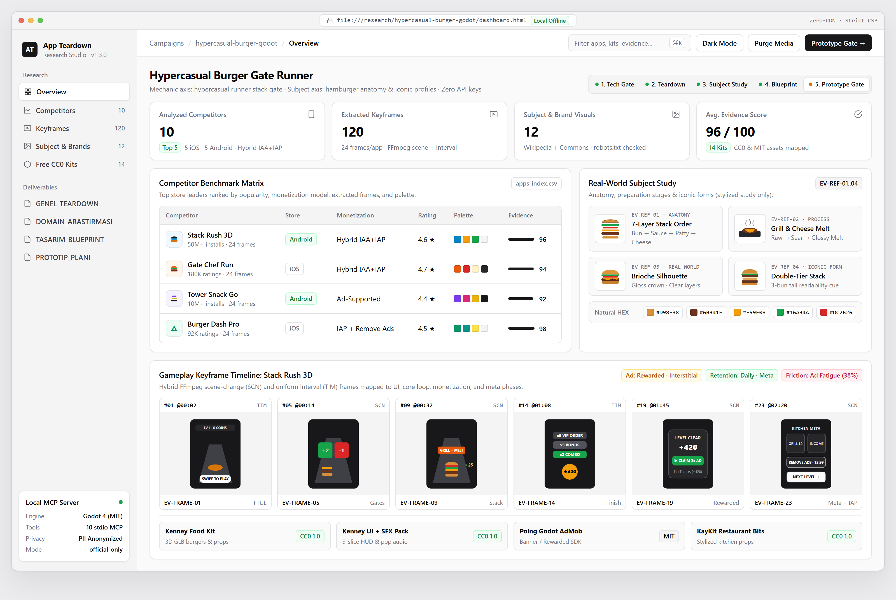

<div align="center">

# App & Game Teardown Research Toolkit

**面向 AI 编程代理的移动应用与游戏立项前竞品分析工具。先选择技术栈（Godot、Unity、Flutter、React Native），从 App Store 与 Google Play 抓取热门前 5 竞品并逐帧拆解 YouTube 实机演示，调研现实主题结构与知名品牌参考图，收集免费 CC0 UI/UX、3D 模型与音效包，先做快速原型收集反馈，再在确认后端到端构建完整版本。**

<p>
  <a href="../../README.md">English</a> ·
  <a href="README.tr.md">Türkçe</a> ·
  <strong>简体中文</strong> ·
  <a href="README.es.md">Español</a> ·
  <a href="README.pt-BR.md">Português</a> ·
  <a href="README.ja.md">日本語</a> ·
  <a href="README.de.md">Deutsch</a> ·
  <a href="README.ko.md">한국어</a>
</p>

<br>

<p>
  
</p>
<p><sub>每次调研完成后自动生成的独立本地仪表板（<code>dashboard.html</code>，零 CDN，严格 CSP，支持浅色与深色 Zinc 主题）。</sub></p>

</div>

---

## 核心功能

- **想法拆解、技术栈建议与玩法/主题分离 (`plan-idea`)：** 先对比 3 套技术方案（Godot 4、Unity 6、Phaser 或 Flutter、React Native、Native）供你确认，再将核心玩法竞品分析与现实主题研究分开处理。
- **现实主题与知名品牌视觉参考引擎 (`research-domain`)：** 通过 Wikipedia 与 DuckDuckGo 整理定义、制作流程、层级结构和知名品牌资料写入 `DOMAIN_ARASTIRMASI.md`，下载参考照片并生成 `domain_reference_sheet.png` 与 `domain_palette_card.png`。
- **免费 UI/UX、3D/2D 模型、音效与 SDK 套件 (`find-kits`)：** 按所选引擎与主题筛选 `CC0`、`MIT`、`SIL OFL` 免费资源（Kenney、KayKit、Quaternius、Poly Pizza、Game-Icons、Freesound CC0、Godot AdMob、RevenueCat），输出 `FREE_ASSET_VE_KIT_REHBERI.md`。
- **双商店热门前 5 竞品发现（零 API 费用）：** 检索 Google Play 与 Apple App Store，按下载量、评分数与相关性排序，抓取 IAP 价格阶梯、广告标记与匿名化用户评论。
- **YouTube 实机演示采集与混合逐帧拆解 (`yt-dlp` + `FFmpeg` + `Pillow`)：** 下载前 4 分钟关键流程，结合场景切换与时间间隔提取 24 帧，生成 3x4 故事板与 `color_palette_card.png` HEX 配色卡。
- **原型 -> 反馈 -> 完整版开发流程 (`PROTOTIP_VE_TAM_SURUM_PLANI.md`)：** 调研与报告完成后先询问是否构建可运行的快速原型，列清完整版将补充的全部内容并收集你的修改意见，确认后再端到端构建完整应用或游戏。
- **官方合规模式与媒体清理 (`--official-only`, `purge-media`)：** 可仅使用官方与开放许可 API（Apple iTunes、Wikipedia、Wikimedia Commons、Openverse），遵守 `robots.txt`，并在报告完成后一键清理第三方媒体、完整保留自写 Markdown 文档。

## 快速安装

```bash
npx skills add https://github.com/koraybaysoy/app-teardown-research
git clone https://github.com/koraybaysoy/app-teardown-research.git
cd app-teardown-research
bash ./setup.sh   # Windows 请运行 .\setup.ps1
```

## 许可证

[MIT](../../LICENSE)
